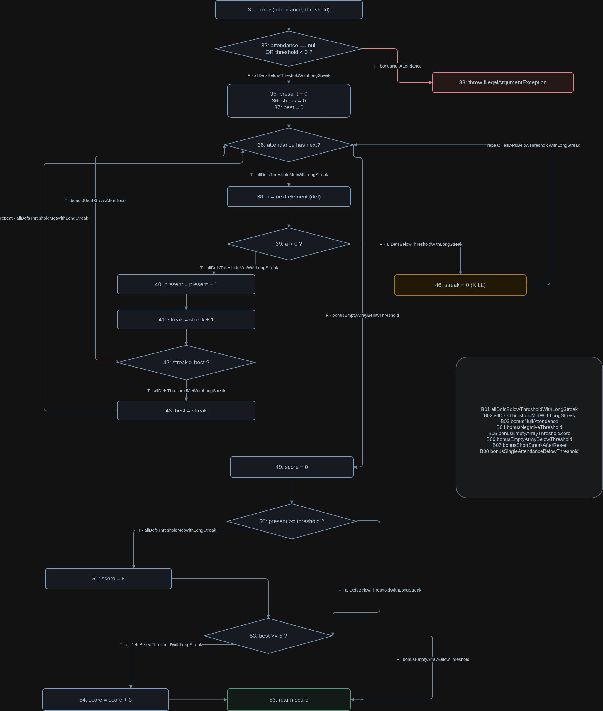

# Лаборатори №10: Өгөгдлийн урсгалын тест — Definition-Use хосууд

**Хичээл:** F.CSA313 — Программ хангамжийн чанарын баталгаа ба тест (2026)  
**Оюутан:** Б.Мөнгөншагай  
**Оюутны код:** B232270013  
**Репозиторий:** https://github.com/B232270013/lab10.git      
**Орчин:**         

[sha@sha lab10]$ java -version 
openjdk version "17.0.21.0.3" 2026-10-24
OpenJDK Runtime Environment (build 17.0.21.0.3+1)
OpenJDK 64-Bit Server VM (build 17.0.21.0.3+1, mixed mode, sharing)
[sha@sha lab10]$ mvn -version
Apache Maven 3.10.0 (c43a36b8d67be7e0805a411bc0898af1a51f5472)
Maven home: /usr/share/java/maven
Java version: 17.0.21.0.3, vendor: Arch Linux, runtime: /usr/lib/jvm/java-17-openjdk
Default locale: en_US, platform encoding: UTF-8, time zone: Asia/Ulaanbaatar
OS name: "linux", version: "6.18.60-1-lts", arch: "amd64", family: "unix"

## Хэсэг A — GCD функцийн DU шинжилгээ

Шинжилгээний эх код: `DataFlowTargets.java`

- Definition: хувьсагч утга авах цэг.
- c-use: хувьсагч тооцоололд ашиглагдах цэг.
- p-use: хувьсагч нөхцөл шалгахад ашиглагдах цэг.
- Def-clear path: тухайн хувьсагч дахин тодорхойлогдоогүй зам.

### A1. DU хосууд

| ID | Хувьсагч | Def | Use | Төрөл | Def-clear зам | Тест | Хамрагдсан |
|---|---|---|---|---|---|---|---|
| DU01 | x | 13 | 16 | c-use | 13→15→16 | G02 | Тийм |
| DU02 | x | 13 | 20 | c-use | 13→15→20 | G01 | Тийм |
| DU03 | x | 17 | 16 | c-use | 17→18→15→16 | G02 | Тийм |
| DU04 | x | 17 | 20 | c-use | 17→18→15→20 | G02 | Тийм |
| DU05 | y | 13 | 15 | p-use T | 13→15→16 | G02 | Тийм |
| DU06 | y | 13 | 15 | p-use F | 13→15→20 | G01 | Тийм |
| DU07 | y | 13 | 16 | c-use | 13→15→16 | G02 | Тийм |
| DU08 | y | 13 | 17 | c-use | 13→15→16→17 | G02 | Тийм |
| DU09 | y | 18 | 15 | p-use T | 18→15→16 | G02 | Тийм |
| DU10 | y | 18 | 15 | p-use F | 18→15→20 | G02 | Тийм |
| DU11 | y | 18 | 16 | c-use | 18→15→16 | G02 | Тийм |
| DU12 | y | 18 | 17 | c-use | 18→15→16→17 | G02 | Тийм |
| DU13 | tmp | 16 | 18 | c-use | 16→17→18 | G02 | Тийм |

### A2. Тестүүдийн тайлбар

**G01 — gcdNoIteration**

`gcd(7,0)` нь 7 буцаана. `y=0` тул while давталт ажиллахгүй. Энэ тест нь анхны `x`-ийн 13→20 хос болон `y`-ийн 13→15 false салааг хамарна.

**G02 — gcdTwoIterations**

`gcd(12,8)` нь 4 буцаана. Давталт хоёр удаа ажиллана. Эхний давталтад `tmp=4`, хоёр дахь давталтад `tmp=0` болно. Энэ тест нь дахин тодорхойлсон `x`, `y`-ийн DU хосууд болон `tmp`-ийн 16→18 хосыг хамарна.

### A3. Дүгнэлт

`gcd` функцэд x, y, tmp гэсэн гурван хувьсагч байна. Нийт 11 ялгаатай def–use цэгийн хос тодорхойлогдсон. p-use-ийн true/false ирмэгүүдийг тусад нь тооцвол хүснэгтэд 13 хамралтын шаардлага байна. G01 болон G02 гэсэн хоёр тестээр эдгээрийг хамруулах боломжтой.

## Хэсэг B — Bonus функцийн өгөгдлийн урсгал

### B1. Bonus функцийн CFG

bonus() функцийн Control Flow Graph-ийг draw.io ашиглан зурсан.

CFG-д оролтын шалгалт, for-each давталт, ирцийн нөхцөл, streak болон best шинэчлэлт, онооны тооцооллыг дүрсэлсэн.

Зангилаануудад DataFlowTargets.java файлын мөрийн дугааруудыг тэмдэглэсэн.

38-р мөрийн for-each давталт нь дараагийн элемент байгаа эсэхийг шалгаж, тухайн элементийг a хувьсагчид онооно.

46-р мөрийн streak = 0 нь өмнөх streak definition-ийг kill хийдэг.

CFG-ийн нөхцөлт ирмэгүүдэд холбогдох JUnit тестийн нэрсийг тэмдэглэсэн.

### B2. Definition / Use жагсаалт

| Мөр | Код / үйлдэл | Definition | Use |
|---|---|---|---|
| 31 | bonus(attendance, threshold) | attendance, threshold | — |
| 32 | attendance == null || threshold < 0 | — | attendance, threshold (p-use) |
| 33 | throw IllegalArgumentException | — | — |
| 35 | present = 0 | present | — |
| 36 | streak = 0 | streak | — |
| 37 | best = 0 | best | — |
| 38 | for (int a : attendance) | a | attendance (p-use) |
| 39 | a > 0 | — | a (p-use) |
| 40 | present = present + 1 | present | present (c-use) |
| 41 | streak = streak + 1 | streak | streak (c-use) |
| 42 | streak > best | — | streak, best (p-use) |
| 43 | best = streak | best | streak (c-use) |
| 46 | streak = 0 | streak | — |
| 49 | score = 0 | score | — |
| 50 | present >= threshold | — | present, threshold (p-use) |
| 51 | score = 5 | score | — |
| 53 | best >= 5 | — | best (p-use) |
| 54 | score = score + 3 | score | score (c-use) |
| 56 | return score | — | score (c-use) |

### B3. All-DU-pairs шинжилгээ

Тэмдэглэгээ:
- T/F: нөхцөлийн үнэн/худал салаа
- c: computational use
- p: predicate use
- B01–B08: BonusTest.java дахь тестийн ID

| Хувьсагч | Def → Use | Төрөл | Def-clear зам | Тест |
|---|---|---|---|---|
| attendance | 31→32 T | p | 31→32→33 | B03 |
| attendance | 31→32 F | p | 31→32→35 | B01 |
| attendance | 31→38 T | p | 31→32→35–38→39 | B01 |
| attendance | 31→38 F | p | 31→32→35–38→49 | B05 |
| threshold | 31→32 T | p | 31→32→33 | B04 |
| threshold | 31→32 F | p | 31→32→35 | B01 |
| threshold | 31→50 T | p | 31→32→35–38→49→50→51 | B02 |
| threshold | 31→50 F | p | 31→32→35–38→49→50→53 | B01 |
| a | 38→39 T | p | 38→39→40 | B01 |
| a | 38→39 F | p | 38→39→46 | B01 |
| present | 35→40 | c | 35→36→37→38→39→40 | B02 |
| present | 35→50 T | p | 35→38→49→50→51 | B05 |
| present | 35→50 F | p | 35→38→49→50→53 | B06 |
| present | 40→40 | c | 40→41→42→43→38→39→40 | B02 |
| present | 40→50 T | p | 40→41→42→43→38→49→50→51 | B02 |
| present | 40→50 F | p | 40→41→42→43→38→49→50→53 | B01 |
| streak | 36→41 | c | 36→37→38→39→40→41 | B02 |
| streak | 41→41 | c | 41→42→43→38→39→40→41 | B02 |
| streak | 41→42 T | p | 41→42→43 | B02 |
| streak | 41→42 F | p | 41→42→38 | B01 |
| streak | 41→43 | c | 41→42→43 | B02 |
| streak | 46→41 | c | 46→38→39→40→41 | B01 |
| best | 37→42 T | p | 37→38→39→40→41→42→43 | B02 |
| best | 37→53 F | p | 37→38→49→50→53→56 | B06 |
| best | 43→42 T | p | 43→38→39→40→41→42→43 | B02 |
| best | 43→42 F | p | 43→38→39→46→38→39→40→41→42 | B07 |
| best | 43→53 T | p | 43→38→49→50→53→54 | B02 |
| best | 43→53 F | p | 43→38→49→50→51→53→56 | B07 |
| score | 49→54 | c | 49→50(F)→53(T)→54 | B01 |
| score | 49→56 | c | 49→50(F)→53(F)→56 | B06 |
| score | 51→54 | c | 51→53(T)→54 | B02 |
| score | 51→56 | c | 51→53(F)→56 | B05 |
| score | 54→56 | c | 54→56 | B01 |

Энэ хүснэгтэд p-use-ийн T/F салаануудыг тусад нь тооцсон 33 шаардлага байгаа.

### B3.1. Kill шинжилгээ

- 40-р мөр present-ийн өмнөх definition-ийг kill хийнэ.
- 41-р мөр streak-ийн өмнөх definition-ийг kill хийнэ.
- 43-р мөр best-ийн өмнөх definition-ийг kill хийнэ.
- 46-р мөр streak-ийг тэглэж, өмнөх definition-ийг kill хийнэ.
- 51-р мөр score-ийн 49-р мөрийн definition-ийг kill хийнэ.
- 54-р мөр score-ийн өмнөх definition-ийг kill хийнэ.

### B3.2. Def-clear биш болон биелэшгүй хос

1. streak 36→42: 41-р мөр streak-ийг заавал
   дахин тодорхойлдог тул def-clear зам байхгүй.
2. streak 41→42: 46-р мөрөөр дамжсан зам
   def-clear биш, учир нь streak дахин тодорхойлогдоно.
3. best 37→42 false: хамгийн эхний ирсэн
   өдөр streak=1, best=0 тул false болох боломжгүй.
4. best 37→53 true: best 0 хэвээр байвал
   best>=5 нөхцөл үнэн болох боломжгүй.
5. score 49→54: 51-р мөрөөр дайрсан зам
   def-clear биш, учир нь score=5 болж өөрчлөгдөнө.
6. score 49→56: 54-р мөрөөр дайрсан зам
   def-clear биш, учир нь score дахин оноогдоно.
7. present 35→50: 40-р мөрөөр дайрсан зам
   def-clear биш, учир нь present шинэчлэгдэнэ.

### B4. All-defs тест

All-defs хамралтад 2 тест сонгов.

| ID | Тестийн метод | Оролт | Хүлээгдэх оноо |
|---|---|---|---|
| B01 | allDefsBelowThresholdWithLongStreak | [1,0,1,1,1,1,1], 7 | 3 |
| B02 | allDefsThresholdMetWithLongStreak | [1,1,1,1,1], 5 | 8 |

B01 тест нь present < threshold, best >= 5 нөхцөлтэй. Иймээс score-ийн 49-р мөрийн definition 54-р мөр дэх use-д хүрнэ.

B02 тест нь present >= threshold, best >= 5 нөхцөлтэй. Иймээс score-ийн 51-р мөрийн definition 54-р мөр дэх use-д хүрнэ.

### M2 — Wrong variable

M2 мутацид 43-р мөрийн `best = streak` үйлдлийг `best = present` болгож өөрчилсөн.

Эхний туршилтад нийт 10 тест ажиллаж, 10 тест амжилттай, 0 алдаатай гарсан.
Иймээс M2 мутаци амьд үлдсэн (Survived).

B01, B02 зэрэг тестүүд нь best-ийн буруу шинэчлэлтийн үр дүнг ялгаж чадаагүй.

Үүнийг шалгахын тулд B09 —
bonusDetectWrongBestUpdate тестийг нэмсэн.

Оролт: [1,1,0,1,1,1], threshold=5.
Зөв кодын үр дүн: 5.
M2 мутацийн үр дүн: 8.

## Хэсэг C — Fault Seeding

### C1. Мутацийн туршилтын үр дүн

| Мутаци | Өөрчлөлт | Нийт тест | Унасан | Үр дүн |
|---|---|---:|---:|---|
| M1 | streak = streak + 1 мөрийг устгасан | 10 | 2 | Killed |
| M2 | best = streak → best = present | 10 | 0 | Survived |
| M2 + B09 | B09 шинэ тест нэмсэн | 11 | 1 | Killed |
| M3 | int total = present + best нэмсэн | 11 | 0 | Survived |

### C2. M1 — Missing update

41-р мөрийн streak = streak + 1 үйлдлийг
устгасан.

Унасан тестүүд:

1. allDefsBelowThresholdWithLongStreak
   - expected: 3
   - actual: 0

2. allDefsThresholdMetWithLongStreak
   - expected: 8
   - actual: 5

Нийт 10 тестээс 2 тест унасан.

streak шинэчлэгдэхгүй бол хамгийн урт
дараалсан ирцийг зөв тооцоолж чадахгүй.
Иймээс нэмэлт 3 оноо олгогдохгүй болсон.

Нотолгоо: results/mvn-test-M1.txt

### C3. M2 — Wrong variable

43-р мөрийн best = streak үйлдлийг
best = present болгож өөрчилсөн.

Эхний 10 тест бүгд амжилттай ажилласан.
Иймээс M2 амьд үлдсэн (Survived).

Шалтгаан нь зарим оролтод present болон
streak ижил утгатай, заримд нь ялгаатай
боловч эцсийн онооны нөхцөлийг өөрчлөхгүй
байсанд оршино.

M2-ийг илрүүлэхийн тулд
bonusDetectWrongBestUpdate (B09) тест нэмсэн.

Оролт:
attendance = [1,1,0,1,1,1]
threshold = 5

Нийт ирсэн өдөр: 5
Хамгийн урт дараалсан ирц: 3

Зөв үр дүн: 5
Мутацийн үр дүн: 8

B09 нэмсний дараа 11 тестээс 1 тест унасан.

Унасан тест:
bonusDetectWrongBestUpdate

expected: 5
actual: 8

Иймээс M2 мутацийг B09 тестээр
амжилттай илрүүлсэн (Killed).

Нотолгоо:
- results/mvn-test-M2.txt
- results/mvn-test-M2-kill.txt

### C4. M3 — Dead definition

Давталтын дараа ашиглагдахгүй хувьсагч нэмсэн:

int total = present + best;

Нийт 11 тест ажиллаж, бүгд амжилттай болсон.

Tests run: 11
Failures: 0
Errors: 0
BUILD SUCCESS

M3 мутаци програмын гаралтыг өөрчлөхгүй.
Учир нь total хувьсагчийг цааш ашиглаагүй.

JUnit тест нь програмын ажиглагдах үр дүнг
шалгадаг тул ашиглагдахгүй definition-ийг
илрүүлэхгүй байж болно.

Нотолгоо: results/mvn-test-M3.txt

### C5. Эх кодыг сэргээсэн байдал

M1, M2, M3 туршилтын дараа DataFlowTargets.java
файлыг git restore ашиглан сэргээсэн.

Эх кодыг өөрчлөлгүй үлдээж,
M2-ийг илрүүлсэн B09 тестийг хадгалсан.

## Эцсийн тест ба JaCoCo хамралт

### All-defs шат

- Tests run: 4
- Failures: 0
- Errors: 0
- BRANCH_COVERED: 13
- BRANCH_MISSED: 3
- LINE_COVERED: 22
- LINE_MISSED: 2
- Branch coverage: 81.25%

### Эцсийн шат

- Tests run: 11
- Failures: 0
- Errors: 0
- BRANCH_COVERED: 16
- BRANCH_MISSED: 0
- LINE_COVERED: 23
- LINE_MISSED: 1
- Branch coverage: 100%
- BUILD SUCCESS

LINE_MISSED = 1 нь DataFlowTargets классын
далд constructor-той холбоотой бөгөөд
лабораторийн зааварт зөвшөөрсөн үзүүлэлт юм.

JaCoCo branch coverage нь DU хамралтыг шууд
хэмждэггүй. Branch 100% болсон ч M2 мутаци
эхний 10 тестийг давж амьд үлдсэн.

Нэмэлт B09 тест нь тестийн оролт болон
хүлээгдэх үр дүнг зөв сонгох чухал болохыг
харуулсан.

Нотолгоо:
- results/mvn-verify-alldefs.txt
- results/jacoco-alldefs.csv
- results/mvn-verify-final.txt
- results/jacoco-final.csv

## Дүгнэлт

Энэ лабораторийн ажлаар gcd болон bonus функцүүдийн өгөгдлийн урсгалд шинжилгээ хийж, Definition–Use хосуудыг тодорхойлсон. All-defs болон all-DU-pairs шалгуурын дагуу JUnit тестүүдийг үе шаттай нэмсэн. All-defs шатанд branch coverage 81.25% байсан бол эцсийн шатанд 100% болсон. Гэхдээ branch coverage 100% байсан ч M2 мутаци эхний 10 тестийг давж амьд үлдсэн нь зөвхөн салаа хамрах нь хангалтгүйг харуулсан. Нэмэлт B09 тестээр нийт ирц болон хамгийн урт дараалсан ирцийн ялгааг шалгаж M2 алдааг илрүүлсэн. M1 мутацийг хоёр тест илрүүлсэн бол M3-ийн ашиглагдахгүй хувьсагчийг JUnit тестүүд илрүүлээгүй. DU шинжилгээ нь хувьсагчдын утгын урсгалыг нарийвчлан шалгах давуу талтай ч def-clear зам, kill болон биелэх боломжтой хосуудыг тодорхойлох нэмэлт ажиллагаа байдаг.

## AI туслах ашигласан тухай
GEMINI - г судалгаа хийх зорилгоор ашигласан.
ChatGPT-ийг README.md-д тайлан бэлтгэхэд ашигласан.

